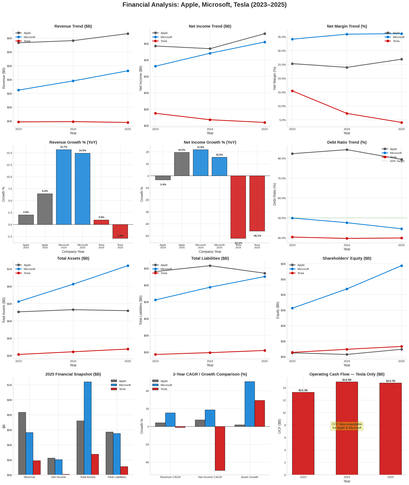

# 📊 BCG Financial Data Analysis

An end-to-end financial data analytics project developed as part of the **BCG Data Science Job Simulation (Forage)**.

This project automates the extraction of financial data from SEC 10-K filings, transforms unstructured financial statements into structured datasets, performs exploratory financial analysis using Python, and presents key business insights through an interactive Power BI dashboard.

---

## 🚀 Project Overview

Financial statements contain valuable insights into a company's profitability, financial health, and operational performance. However, SEC 10-K filings are lengthy HTML documents that are difficult to analyze manually.

This project builds an automated pipeline that:

- Extracts financial data from SEC filings
- Cleans and structures the extracted information
- Performs exploratory financial analysis
- Generates business insights
- Visualizes results using Power BI

---
## 📊 Project Dashboard
<p align="center">
  
</p>




## 🎯 Objectives

- Automate financial data extraction from SEC filings
- Build a reusable financial data pipeline
- Perform financial analysis using Pandas
- Generate business insights from structured financial data
- Design an interactive Power BI dashboard

---

# 🛠️ Technologies Used

| Category | Tools |
|-----------|------|
| Programming | Python |
| Data Analysis | Pandas |
| Web Scraping | Requests, Regex |
| Data Source | SEC EDGAR 10-K Filings |
| Notebook | Jupyter Notebook |
| Visualization | Power BI |
| Version Control | Git & GitHub |

---

# 📂 Project Structure

```
BCG-Financial-Data-Analysis
│
├── data/
├── documentation/
├── output/
│
├── financial_analysis.ipynb
├── financial_scraper.py
├── financial_csv.py
├── scraper.py
├── companies.py
├── urls.py
├── main.py
│
├── financial_data.csv
├── requirements.txt
└── README.md
```

---

# 🔄 Project Workflow

```
SEC 10-K Filings
        │
        ▼
Python Web Scraper
        │
        ▼
Financial Statement Extraction
        │
        ▼
Data Cleaning (Pandas)
        │
        ▼
Exploratory Data Analysis
        │
        ▼
Business Insights
        │
        ▼
Power BI Dashboard
```

---

# 📈 Financial Metrics Extracted

The scraper automatically extracts:

- Revenue
- Net Income
- Total Assets
- Total Liabilities
- Operating Cash Flow

from SEC 10-K annual reports.

---

# 📊 Exploratory Data Analysis

The project includes:

- Dataset overview
- Missing value analysis
- Financial trend analysis
- Company comparison
- Revenue analysis
- Asset vs Liability comparison
- Profitability analysis

---

# 📉 Dashboard

The Power BI dashboard provides interactive visualizations including:

- Revenue comparison
- Net Income comparison
- Total Assets
- Total Liabilities
- Operating Cash Flow
- Company-wise financial performance
- Year-wise financial trends

> Dashboard screenshot available in the `documentation` folder.

---

# 💡 Key Business Insights

- Microsoft demonstrated consistent revenue and profitability growth across the analyzed years.
- Apple maintained strong financial stability with high asset values and profitability.
- Tesla experienced revenue fluctuations while continuing to expand its asset base.
- Comparative analysis highlighted differences in capital structure and operational performance among the three companies.

---

# 📚 Skills Demonstrated

- Python Programming
- Financial Data Analysis
- Exploratory Data Analysis (EDA)
- Web Scraping
- Data Cleaning
- Data Visualization
- Business Intelligence
- Power BI
- Pandas
- Financial Statement Analysis

---

# 📁 Repository

GitHub Repository:

https://github.com/faizur55/bcg-financial-data-analysis

---

# 🙏 Acknowledgements

This project was completed as part of the **BCG Data Science Job Simulation** hosted on **Forage**.

The simulation provided practical exposure to solving real-world financial analytics problems using data science techniques.

---

# 👨‍💻 Author

**Shaik Faizur Rahaman**

GitHub:
https://github.com/faizur55

LinkedIn:
(Add your LinkedIn profile here)

---

## ⭐ If you found this project interesting, feel free to star the repository!